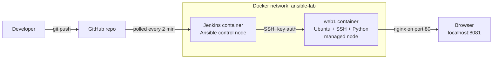

# Ansible + Jenkins: Automated Nginx Deployment

A Jenkins pipeline that uses **Ansible** to configure a server from scratch: it installs nginx, deploys a custom homepage and starts the service. A push to GitHub starts the pipeline automatically, and it includes a syntax check, a dry run, a manual approval gate and a smoke test.

The whole lab runs locally in **Docker**. An Ubuntu container acts as the target server, and Jenkins runs in a second container on the same network.


---

## What this project demonstrates

- **Configuration management with Ansible:** an idempotent playbook that describes the desired state of the server.
- **CI/CD with Jenkins:** pipeline as code (`Jenkinsfile`), started automatically by SCM polling.
- **Safe change practices:** syntax check → dry run (`--check --diff`) → human approval → deploy → smoke test.
- **Secrets handling:** SSH key authentication. The private key is stored in Jenkins' credential store, masked in logs, and never committed to Git.
- **Environment separation:** one playbook, with a separate inventory for each control node (laptop and Jenkins).
- **Docker:** custom images for the target server and for Jenkins with Ansible installed, connected on a user-defined network.

---

## Architecture



| Component | Role |
| --- | --- |
| `web1` | Target server: Ubuntu 22.04 with OpenSSH, Python 3 and an `ansible` user with sudo |
| `jenkins` | Jenkins LTS with Ansible installed; the control node that runs the pipeline |
| GitHub | Source of truth for the playbook, inventories and Jenkinsfile |

---

## The pipeline

| Stage | What it does | Why it matters |
| --- | --- | --- |
| **Syntax check** | `ansible-playbook --syntax-check` | Catches broken YAML before anything touches a server |
| **Dry run** | `ansible-playbook --check --diff` | Shows exactly what would change, as evidence for a change review |
| **Approve** | Pauses for manual approval | A human gate before changes are applied (continuous delivery) |
| **Deploy** | Runs the playbook against `web1` | Applies the change using the SSH key from Jenkins credentials |
| **Smoke test** | `curl` the site and check its content | Proves the service actually works after the change |

The pipeline is **fail-fast**: if any stage fails, the later stages are skipped and nothing is deployed.


---

## The playbook

`site.yml` describes the desired state of the server rather than the commands to run:

```yaml
- name: Configure web server
  hosts: web
  become: true
  tasks:
    - name: Install Nginx
      ansible.builtin.apt:
        name: nginx
        state: present
        update_cache: true

    - name: Start Nginx service
      ansible.builtin.service:
        name: nginx
        state: started

    - name: Copy index.html to web server
      ansible.builtin.copy:
        src: index.html
        dest: /var/www/html/index.html
```

### Idempotency

The first run reports `changed` for each task. A second run reports `changed=0`, because the server is already in the desired state. Running the playbook again is always safe.


---

## Repository structure

```text
.
├── Jenkinsfile            # Pipeline as code
├── site.yml               # Ansible playbook
├── index.html             # Homepage deployed to the server
├── ansible.cfg            # Project-level Ansible settings
├── inventories/
│   ├── local.ini          # For running from a laptop (127.0.0.1:2222)
│   └── jenkins.ini        # For running from Jenkins (web1 on the Docker network)
├── target/
│   ├── Dockerfile         # Ubuntu target server with SSH + Python
│   └── authorized_keys    # Public key only
├── jenkins/
│   └── Dockerfile         # Jenkins LTS with Ansible installed
└── .gitignore             # Keeps private keys and local files out of Git
```

**Why two inventories?** From a laptop, the target is reached through Docker's published port (`127.0.0.1:2222`). From Jenkins, it is reached by container name (`web1:22`) on the shared Docker network. The playbook stays the same; only the inventory changes.

---

## Run it yourself

**Prerequisites:** Docker, Git, Ansible (`pip install ansible`). On Windows, use WSL.

### 1. Create an SSH key and start the target

```bash
ssh-keygen -t ed25519 -f ~/.ssh/ansible_lab -N ""
cp ~/.ssh/ansible_lab.pub target/authorized_keys

docker network create ansible-lab
docker build -t ansible-target ./target
docker run -d --name web1 --network ansible-lab -p 2222:22 -p 8081:80 ansible-target
```

### 2. Run the playbook from your machine

```bash
ansible -i inventories/local.ini web -m ansible.builtin.ping
ansible-playbook -i inventories/local.ini site.yml --check --diff
ansible-playbook -i inventories/local.ini site.yml
```

Open http://localhost:8081.

### 3. Run it through Jenkins

```bash
docker build -t jenkins-ansible ./jenkins
docker run -d --name jenkins --network ansible-lab -p 8080:8080 \
  -v jenkins_home:/var/jenkins_home jenkins-ansible
docker exec jenkins cat /var/jenkins_home/secrets/initialAdminPassword
```

1. Open http://localhost:8080, unlock Jenkins and install the suggested plugins.
2. Add a credential: **SSH Username with private key**, ID `ansible-lab-key`, username `ansible`, with the contents of `~/.ssh/ansible_lab`.
3. Create a **Pipeline** job: *Pipeline script from SCM* → Git → this repo → branch `*/main` → script path `Jenkinsfile`.
4. Click **Build Now** once. After that, every push starts a build automatically.

---

## Problems I hit and how I fixed them

| Problem | Cause | Fix |
| --- | --- | --- |
| `the playbook: website.yml could not be found` | The Jenkinsfile referenced a different file name from the playbook in the repo | Corrected the name in the Jenkinsfile |
| `Load key: error in libcrypto` / `Permission denied (publickey)` | The private key pasted into Jenkins credentials was malformed | Re-pasted the full key, including the BEGIN/END lines and the final newline |
| Ansible interpreter discovery warning | Ansible was guessing which Python to use on the target | Set `ansible_python_interpreter=/usr/bin/python3` explicitly in the inventory |

---

## What I'd do differently in production

- **Real servers:** VMs provisioned with **Terraform**, using a **dynamic inventory** instead of static files.
- **Webhooks instead of polling:** a GitHub webhook to start builds immediately. Polling is used here because a local Jenkins can't be reached from GitHub.
- **Host key checking on:** known host keys managed properly instead of disabled.
- **Secrets management:** Ansible Vault or a secrets manager such as HashiCorp Vault or CyberArk for passwords and keys.
- **Roles and testing:** split the playbook into a reusable **role**, lint it with `ansible-lint`, and test it with **Molecule** in the pipeline.
- **Multiple environments:** separate dev, test and prod inventories, with **rolling updates** (`serial`) in production.
- **Least privilege:** a narrower sudo rule for the automation user instead of full `NOPASSWD:ALL`.

---

## Author

**Tanvir Ahmed**, DevOps Engineer.

[LinkedIn](https://www.linkedin.com/in/tanvir-ahmed7) · [GitHub](https://github.com/tanvir039)